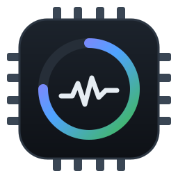
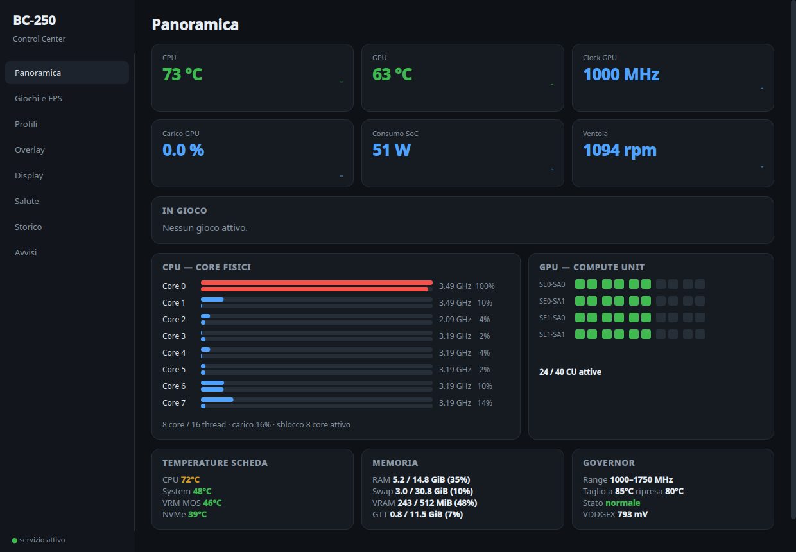
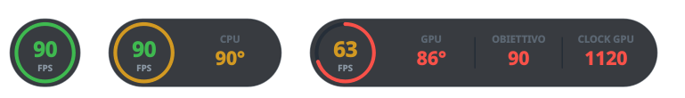
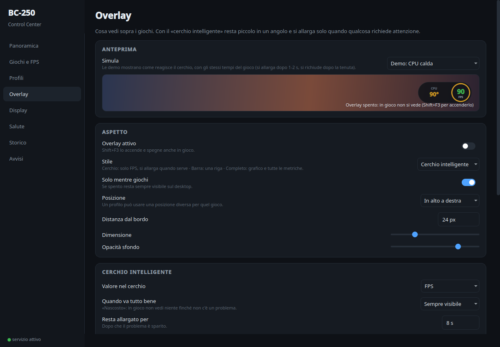

<p align="center">
  
</p>

<h1 align="center">BC-250 Gaming Control Center</h1>

<p align="center">
  <b>FPS limiter, in-game overlay, per-game profiles and session history for the AMD BC-250 on Linux.</b><br>
  <sub>Built for Bazzite / KDE Plasma (Wayland). No MangoHud needed.</sub>
</p>

<p align="center">
  
  
  
  
</p>

---

The AMD BC-250 is a crypto-mining board built around a cut-down PS5 APU (Cyan Skillfish: 6–8 Zen 2 cores,
24 RDNA1 CUs). It makes a great cheap gaming box, but it runs hot, often has a single fan and needs some
babysitting. This app keeps an eye on it while you play and lets you tune each game without leaving it.

**📖 [Read the full documentation →](docs/README.md)**

<p align="center">
  
</p>

## Features

- **Own FPS engine**: an implicit Vulkan layer plus an `LD_PRELOAD` OpenGL shim that count frames and cap FPS.
  You can change the limit live (no game restart) with **Shift+F1** or from the app.
  → [How the engine works](docs/architecture.md#fps-engine-layer) · [Making games use it](docs/installation.md#making-games-use-the-engine)
- **Smart bubble overlay**: a small 56 px circle with your FPS. It **expands only when something needs
  attention**: CPU/GPU too hot, FPS below target, stutter (low 1% lows), GPU clock throttling, RAM almost full
  or the fan stopped. When everything is fine it can stay visible, fade out or hide completely.
  A compact bar and a full panel are also available.
  → [Overlay styles and rules](docs/overlay.md#smart-bubble)
- **Full ring overlay**: a 112 px watch-face with FPS in the middle and four live gauges around it
  (CPU/GPU temperature, power, GPU clock, load, RAM, fan, 1% low: you pick them). Everything at a glance,
  with a coloured halo when something needs attention.
  → [Full ring](docs/overlay.md#full-ring)
- **In-game details panel** (**Shift+F2**): live graphs, system info and an editable game profile, driven
  with the arrow keys.
  → [Details panel](docs/overlay.md#details-panel-shiftf2)
- **Per-game profiles**: FPS limit, max GPU clock, VRR, heat guard (drops 10 FPS every 20 s above a CPU
  temperature, then recovers), and overlay visibility, position and style.
  → [Game profiles](docs/profiles.md) · [Heat guard](docs/profiles.md#heat-guard)
- **VRR only in games**: FreeSync turns on when a game whose profile asks for it starts, and goes back off on
  the desktop.
  → [VRR](docs/profiles.md#vrr)
- **Session history** grouped by game: FPS, 1% lows, temperatures, clocks and power for every session.
  Alt+tab or long loading screens do not split a session.
  → [Session history](docs/history.md)
- **Health checks and alerts**: desktop notifications and on-screen toasts for temperature, fan and RAM.
  → [Alert settings](docs/configuration.md#alerts) · [Troubleshooting](docs/troubleshooting.md)
- **In-game graphics settings**: reads each game's own settings (Unreal Engine, Unity, No Man's Sky) at
  launch, records changes you make while playing as marks in the session, and applies settings from the
  game profile when the game closes, with backups. An AI assistant can tune them through MCP.
  → [In-game graphics settings](docs/graphics.md)
- **FSR upscaling for any game, plug & play**: one switch puts the `bc250-run` launcher in every Steam, Lutris
  and Heroic game (keeping your options), then the game profile can run
  it at 77/67/59/50 % resolution inside gamescope, upscaled with AMD FSR 1. More FPS and less heat on the
  BC-250's single fan. Games you install later are detected and you get a notification asking whether to
  link them. → [Upscaling](docs/graphics.md#upscaling-for-any-game-bc250-run)
- **Real GPU clock for every tool on 8-core boards**: after the 8-core unlock the SMU metrics table
  loses the GPU clock, so MangoHud, the Steam overlay and LACT show 3–100 MHz. `bc250-metricsfix`
  (a small root service) writes the real clock, read by
  [cyan-skillfish-governor](https://github.com/filippor/cyan-skillfish-governor) with `fix-freq = true`,
  into `gpu_metrics` and `pp_dpm_sclk`.
  → [Real GPU clock on 8-core boards](docs/gpu-clock-8core.md)
- **MCP server**: lets an AI assistant (e.g. Claude Code) read live stats and history, mark moments
  during a test and change FPS limits, GPU clock and profiles. Useful for finding the best settings together.
  → [MCP server](docs/mcp.md)

<p align="center">
  <br>
  <sub>The bubble overlay: all good · CPU getting hot · GPU hot and clock throttled</sub>
</p>

<p align="center">
  
</p>

## Documentation

Full docs live in [`docs/`](docs/README.md):

- [Installation](docs/installation.md): requirements, installer steps, launch options, uninstall
- [Overlay](docs/overlay.md): the four HUD styles, smart bubble rules, full ring, Shift+F2 panel
- [Game profiles](docs/profiles.md): matching, FPS limit priority, heat guard, VRR, GPU clock
- [Session history](docs/history.md): what is recorded and how sessions survive alt+tab
- [In-game graphics settings](docs/graphics.md): read, track and tune each game's own graphics options
- [Real GPU clock on 8-core boards](docs/gpu-clock-8core.md): why tools show 10 MHz and how it is fixed
- [MCP server](docs/mcp.md): tools for AI assistants
- [Configuration reference](docs/configuration.md): every setting, file and command
- [Architecture](docs/architecture.md): how the pieces fit, shared-memory format, source map
- [Troubleshooting](docs/troubleshooting.md)

## How it works

> Deep dive: [Architecture](docs/architecture.md), including the shared-memory format and a source map.

| Component | What it does |
|---|---|
| `layer/` (C) | `libbc250_vk.so` (implicit Vulkan layer) and `libbc250_gl.so` (OpenGL `LD_PRELOAD`). They count frames and apply the FPS cap, sharing a small memory-mapped file with the daemon. |
| `bc250d` | User service: sensors, running game, profiles, SQLite history, alerts. Writes the live state to `/dev/shm/bc250-$UID/state.json`. |
| `bc250-overlay` | HUD, details panel and toasts as Wayland layer-shell surfaces, so they stay on top of fullscreen games. |
| `bc250-control` | The desktop app (PyQt6). |
| `bc250-run` | Universal launcher (`bc250-run %command%`): applies the profile's FSR upscaling through gamescope, or starts the game unchanged. |
| `bc250ctl` | Quick commands: `toggle-limit`, `toggle-panel`, `toggle-hud`, `limit <n\|off>`, `status`. |
| `bc250-mcp` | MCP server (stdio) for AI assistants. |
| `bc250-metricsfix` | Root service (installed with `sudo`): real GPU clock in `gpu_metrics` / `pp_dpm_sclk` on 8-core BC-250s. Starts and restarts with the governor. |

The GPU clock range is controlled through the D-Bus interface of
[cyan-skillfish-governor](https://github.com/filippor/cyan-skillfish-governor).

## Install

> Step by step, requirements and uninstall: [Installation](docs/installation.md).

Requirements: KDE Plasma 6 on Wayland (LayerShellQt), Python 3 with PyQt6 and PyGObject, `gcc` and `make`.
For GPU clock control, [cyan-skillfish-governor](https://github.com/filippor/cyan-skillfish-governor) with
D-Bus enabled.

```sh
git clone https://github.com/zxcvbinz/bc250-gaming-control-center.git
cd bc250-gaming-control-center
python3 -m bc250.install            # one command: everything below happens automatically
python3 -m bc250.install --remove   # uninstall everything
```

That single command builds and enables the FPS engine (loaded automatically into every Vulkan/Proton game),
starts the services, registers the shortcuts, puts the `bc250-run` launcher into every Steam, Lutris and
Heroic game (Steam is closed and reopened for a few seconds; your launch options are kept; use
`--no-launcher` to skip) and, with `sudo`, installs the 8-core GPU clock fix. Nothing to configure per game.

- Turn the engine off for one game: `DISABLE_BC250_LAYER=1 %command%`.

## Shortcuts

> Everything about the HUD and the in-game panel: [Overlay](docs/overlay.md).

| Keys | Action |
|---|---|
| **Shift+F1** | FPS limit on/off |
| **Shift+F2** | Details panel (arrow keys edit the game profile, Esc closes) |
| **Shift+F3** | Overlay on/off |

You can rebind them in System Settings → Shortcuts → "BC-250".

## Files

> Every setting and path: [Configuration reference](docs/configuration.md).

| Path | Content |
|---|---|
| `~/.config/bc250/config.json` | Settings and profiles |
| `~/.local/share/bc250/history.db` | Session history (SQLite) |
| `~/.local/lib/bc250/` | FPS engine libraries |
| `~/.local/share/vulkan/implicit_layer.d/bc250_frame.json` | Vulkan layer manifest |

A session stays open while a game is briefly gone (alt+tab, loading). If the same game comes back within
`history.merge_gap_s` (300 s), the session continues.

## Notes

- The app is available in **Italian and English** (picker at the bottom of the sidebar; the overlay and notifications follow it live). More languages: add a `bc250/lang_xx.py` file and an entry in `bc250/i18n.py`.
- Tested on a BC-250 running Bazzite (Fedora 43), kernel 6.17, Mesa 26, with the 8-core unlock.
